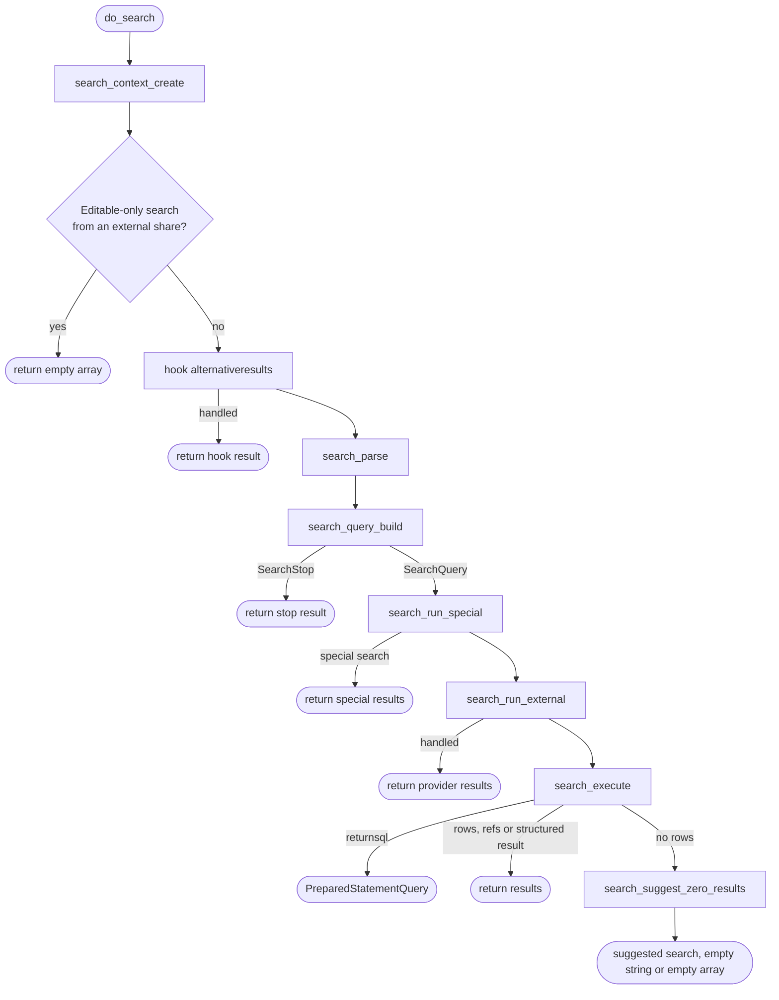
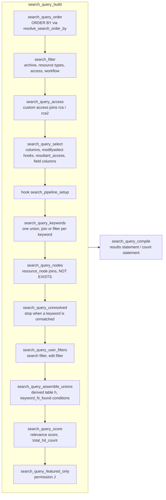
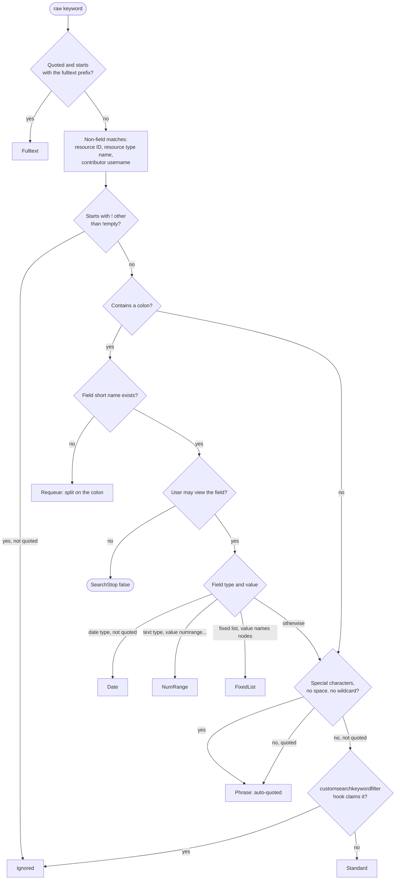
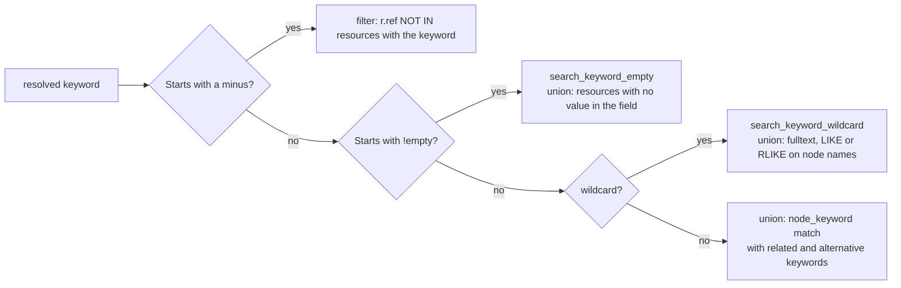
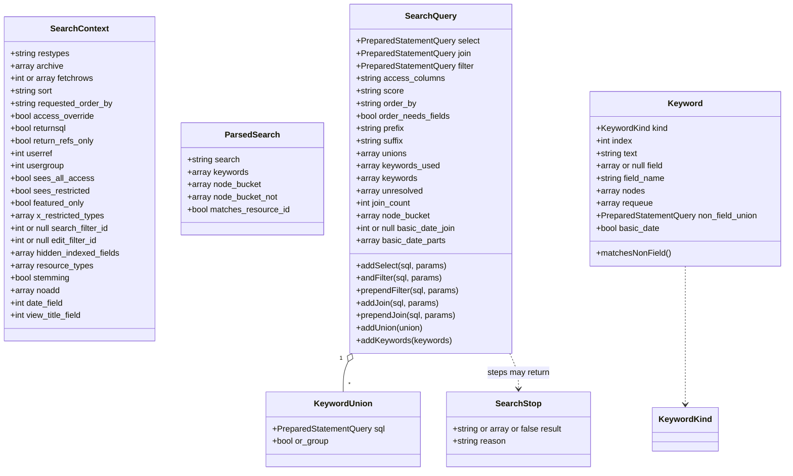

# The do_search() pipeline

`do_search()` turns a search string into a result set. It used to be one 500-line function plus five include
files that shared its local scope. It is now a short facade over a pipeline of plain functions with three value
objects passed between them:

| Object | Built by | Holds |
| --- | --- | --- |
| `SearchContext` | `search_context_create()` | Who is searching, with which options, under which permissions and configuration. Read-only. |
| `ParsedSearch` | `search_parse()` | The search string split into keywords and node restrictions; a special search keeps its identifier in the string. |
| `SearchQuery` | `search_query_build()` | The SELECT, JOIN and WHERE fragments, keyword unions and ORDER BY being assembled. |

A step that must end the search early (no access to a field, or a suggested search instead of results) returns a
`SearchStop` carrying the value `do_search()` gives back to its caller.

## Files

| File | Contents |
| --- | --- |
| `include/do_search.php` | `do_search()` facade, `search_run_special()`, `search_run_external()`, `search_execute()`, `search_suggest_zero_results()` |
| `include/search_context.php` | `SearchContext`, `search_context_create()`, legacy filter migration (`resolve_user_search_filter()`, `resolve_user_edit_filter()`) |
| `include/search_parse.php` | `ParsedSearch`, `search_parse()`, `resolve_given_nodes()` |
| `include/search_query.php` | `SearchQuery`, `KeywordUnion`, `SearchStop`, `search_query_build()` and the non-keyword pipeline steps, `search_query_compile()`, `search_query_compile_count()` |
| `include/search_keywords.php` | `KeywordKind`, `Keyword`, `search_query_keywords()`, `search_keyword_classify()` and one function per keyword kind |
| `include/search_functions.php` | Helpers kept from the previous implementation: `search_filter()`, `search_special()`, `resolve_search_order_by()` (which `set_search_order_by()` now wraps), `resolve_keyword()`, `get_filter_sql()` |

`include/boot.php` loads them in that order.

Each diagram below is Mermaid source, rendered to a PNG in `documentation/images/` for viewers that do not
render Mermaid. Regenerate the images when the source changes.

## Call flow




`search_special()` and the `external_search` hook keep their original signatures. `search_run_special()` and
`search_run_external()` unpack the `SearchQuery` and the context for them, so `do_search()` itself reads as the
sequence above. The external search hook is handed the options as the caller passed them.

## Building the query

`search_query_build()` runs these steps in order. Each is a plain function taking the context, the query and,
where needed, the parsed search. The steps after the `search_pipeline_setup` hook depend on one another (keywords
add nodes, nodes and unions feed the score), and `search_query_build()` notes each dependency where it calls the step.




What each step touches on the `SearchQuery`:

| Step | select | join | filter | unions | score / order |
| --- | --- | --- | --- | --- | --- |
| `search_query_order` | | | | | order_by, order_needs_fields |
| `search_filter` | | | adds (the base filter) | | |
| `search_query_access` | | adds | adds | | |
| `search_query_select` | sets | | | | |
| `search_query_keywords` | | adds (dates, ranges) | adds (omit, dates, ranges) | adds | |
| `search_query_nodes` | | adds | prepends NOT EXISTS | | hitcount_select |
| `search_query_user_filters` | | | adds | | |
| `search_query_assemble_unions` | | adds derived table | adds union condition | consumes | |
| `search_query_score` | adds total_hit_count | | | | score |
| `search_query_featured_only` | | prepends | | | |

`search_query_compile()` produces:

```sql
{prefix} SELECT DISTINCT {score} score, {select} FROM resource r {join}
WHERE {filter} GROUP BY r.ref, user_access, group_access ORDER BY {order_by} {suffix}
```

`search_query_compile_count()` gives the count statement used for paging: the same FROM, WHERE and GROUP BY with only `r.ref` and the two access
columns selected, which measured 1.1x to 4.0x faster than counting the full row. Disk-usage searches (which wrap
the statement in `{prefix}` and `{suffix}`) keep the full form because the wrapper reads the columns.

## Keywords

`search_query_keywords()` walks `SearchQuery::$keywords` by index. A handler may append tokens to that list (a
term containing a colon that is not a field name, or a term containing configured separators), so the loop
re-reads the count each time. The index identifies a keyword in `SearchQuery::$unresolved` and in SQL aliases.

`search_keyword_classify()` does all the string inspection once and returns a `Keyword` with a kind:




Each kind has one handler:

| Kind | Handler | Adds |
| --- | --- | --- |
| Fulltext | `search_keyword_fulltext()` | union: `MATCH(name) AGAINST` over node names |
| Date | `search_keyword_date()` | joins and filters on the date field; basicyear/month/day share one join |
| NumRange | `search_keyword_numrange()` | join and range filter on a text field |
| FixedList | (inline) | the resolved nodes go to `SearchQuery::$node_bucket` |
| Phrase | `search_keyword_phrase()` | union requiring adjacent keyword positions in one node, or a NOT IN filter for `-"..."` |
| Standard | `search_keyword_standard()` | see below |
| Requeue | (loop) | the split tokens are appended to the keyword list |
| Ignored | (none) | |

`search_keyword_standard()` resolves the keyword (stemmed, then unstemmed), queues separator-split parts, records
an unmatched plain keyword for the suggestion, then adds one of:




Three helpers are shared by the handlers: `search_keyword_restriction()` builds the clause excluding hidden
fields, fields excluded by the `excludefieldsfromkeywordsearch` hook and, for field-specific terms, every other
field (the phrase handler passes the alias of each word's `node_keyword` join); `search_keyword_alternatives()`
handles `red;blue`; `search_keyword_related()` adds related keywords, including stems when stemming is on.

## Union assembly

Each keyword contributes a `KeywordUnion`: a SELECT returning `resource`, a `[bit_or_condition]` placeholder and
a score, plus a flag saying whether it is an alternative to its neighbours. `search_query_assemble_unions()`
numbers them, fills the placeholders, and joins one derived table:

```sql
JOIN (
    SELECT resource, sum(score) AS score,
           BIT_OR(keyword_1_found) AS keyword_1_found, BIT_OR(keyword_2_found) AS keyword_2_found
    FROM (
        SELECT resource, TRUE AS keyword_1_found, FALSE AS keyword_2_found, hit_count AS score FROM ... -- keyword 1
        UNION
        SELECT resource, FALSE AS keyword_1_found, TRUE AS keyword_2_found, hit_count AS score FROM ... -- keyword 2
    ) AS hits GROUP BY resource
) AS h ON h.resource = r.ref
```

and the WHERE condition `(h.keyword_1_found) AND (h.keyword_2_found)`. Consecutive unions flagged as
alternatives are OR'd within one bracket; the summed score becomes the relevance score.

## Objects




Only `SearchQuery` is mutable; the context, the parsed search and each `Keyword` are readonly. Keyword matching
copies the parsed keywords and node bucket onto the query and adds to them there. Steps change the query only
through its methods, so a reader can find every place a fragment is built by searching for the method name.

## Hooks

| Hook | Fired from | Arguments |
| --- | --- | --- |
| `modifyfetchrows` | `search_context_create()` | fetchrows |
| `alternativeresults` | `do_search()` | go |
| `dosearchmodifykeywords` | `search_parse()` | keywords, search |
| `modifyselect`, `modifyselect2` | `search_query_select()` | none; the return value is appended to the select |
| `search_pipeline_setup` | `search_query_build()` | search, select, join, filter, "" (objects, so plugins can append). May set the global `$keysearch` to false to skip keyword matching |
| `customsearchkeywordfilter` | `search_keyword_classify()` | [field name, value] |
| `excludefieldsfromkeywordsearch` | `search_keyword_standard()`, `search_keyword_phrase()` | none; returns field refs to exclude |
| `external_search` | `search_run_external()` | the call arguments plus filter, join, select |
| `beforereturnresults` | `search_execute()` | result, archive |
| `zero_search_results` | `search_suggest_zero_results()` | none |

Two ordering differences from the previous implementation: `modifyfetchrows` now fires while the context is
built, before `alternativeresults`; and the legacy text-filter migration runs at context creation even for
searches that return early.

## Extending

To add a keyword form: add a case to `KeywordKind`, detect it in `search_keyword_classify()`, write a
`search_keyword_<kind>()` function that adds to the `SearchQuery`, and dispatch it in `search_query_keywords()`.
To add a pipeline step: write `search_query_<step>(SearchContext $ctx, SearchQuery $query)` and call it from
`search_query_build()` at the right point. Steps take what they need from the context; a step that keeps to that
can be exercised with a hand-built `SearchContext`. Two places still touch globals: `$keysearch` in
`search_query_build()`, and the helpers kept from the previous implementation (`resolve_search_order_by()`,
`search_filter()`, `get_filter_sql()`), which read configuration globals of their own.

## Tests and tools

| Check | What it does |
| --- | --- |
| `tests/test_list/000705_do_search_sql_snapshot.php` | Runs 116 searches, including every special search branch, with `$returnsql` for three permission profiles and compares the normalised SQL and parameters with `tests/test_data/do_search_sql_snapshot.json`. Any change to the generated SQL fails it. Regenerate only on code known to be correct: `RS_TEST_UPDATE_SNAPSHOTS=1 php tests/test.php 705`. |
| `tests/test_list/000706_do_search_keyword_restrictions.php` | Excluded and hidden fields are both bound in every keyword union, with matching placeholders. |
| `tests/test_list/000707_do_search_zero_result_suggestion.php` | A search whose keywords never occur together suggests dropping the least used one. |
| `tests/test_list/000708_do_search_editable_states.php` | Editable-only searches exclude each configured additional archive state the user cannot edit. |
| `tests/test_list/000701_do_search_special_states.php` | `!archivepending`, `!userpending`, `!resource` and `!listall` against resources in each workflow state. |
| `tests/test_list/000702_do_search_special_images.php` | `!images`, `!colourkey`, `!colour`, `!rgb` and `!geo` against preview columns written directly. |
| `tests/test_list/000703_do_search_order_by.php` | Every named ordering in `resolve_search_order_by()`, plus the fallback for an unknown value. |
| `tests/test_list/000704_do_search_result_options.php` | Row limit padding, chunked fetchrows, refs only, disk usage totals, the recent days limit and the archive list. |
| `tests/test_list/000709_do_search_hooks.php` | The keyword, select, special search, editable filter, fetchrows, alternative results, before-return and zero-results hooks through a test plugin. |
| `tests/test_list/000711_do_search_special_properties.php` | Every `!properties` option, their combination, ignored values and a node restriction. |
| `tests/test_list/000712_do_search_special_flags.php` | `!integrityfail`, `!locked`, `!nopreview`, `!hasdata`, `!contributions` and `!last` against resource columns written directly. |
| `tests/test_list/000713_do_search_special_collection.php` | `!collection` members in every archive state, collection columns and ordering, `$collections_omit_archived`, a node restriction and access for a non-administrator. |
| `tests/test_list/000714_do_search_special_results.php` | Row limit padding, chunked fetchrows, the reduced refs-only query, disk usage and returned SQL for a special search. |
| `tests/test_list/000460` to `000700` | The pre-existing behaviour tests. |

The snapshot does not cover the count statement or execution. Those are covered by the behaviour tests, which
page through real results.

## Behaviour changes made during the restructuring

Each of these was a defect in the previous code, confirmed by a failing test or by reading:

- A wildcard union overwrote its field restriction clause instead of appending to it, while merging both
  parameter sets.
- The `!empty` visibility check called `explode()` on the hook's array, which throws on PHP 8.
- `!emptyFIELDNAME` bound the field name as an integer, so MySQL matched the first field with a non-numeric name.
- Quoted phrases applied the `excludefieldsfromkeywordsearch` hook only if an earlier keyword had already called it.
- A date range term reused a start or end bound left over from an earlier keyword in the same search.
- The zero-result suggestion bound keyword text as an integer and so picked the least used keyword of the whole
  table.
- An edit filter with no rules produced a dangling `AND`.
- A keyword that is a wildcard too short for the stop word pattern built an empty statement.
- An `!empty` search naming no field, or a field that does not exist, returns `false` (no results, as for a field
  the user may not see) instead of ending the page with `exit()`. An unloadable user search filter still exits,
  because that is a configuration fault administrators must notice.
- An `!empty` search on a non-global field whose resource types are not among the searched types built `IN ()`,
  a syntax error. It now matches every searched resource, since none of them can hold the field.
- A wildcard keyword that takes the LIKE path and also matches a resource type or contributor name merged the
  parameters of that match without its SQL. The match is now appended to the union, as on the other wildcard paths.
- `!emptyFIELDNAME` with a special character in the short name (`!emptysnap_under`) was quoted into a phrase
  search or split at the configured separator, and returned `false`. It is now handled as an `!empty` search.

Known and left alone: two consecutive alternative keywords (`a;b c;d`) are OR'd together rather than both
required; ordering by a field outside the configured table joins fails inside `resolve_search_order_by()`.
