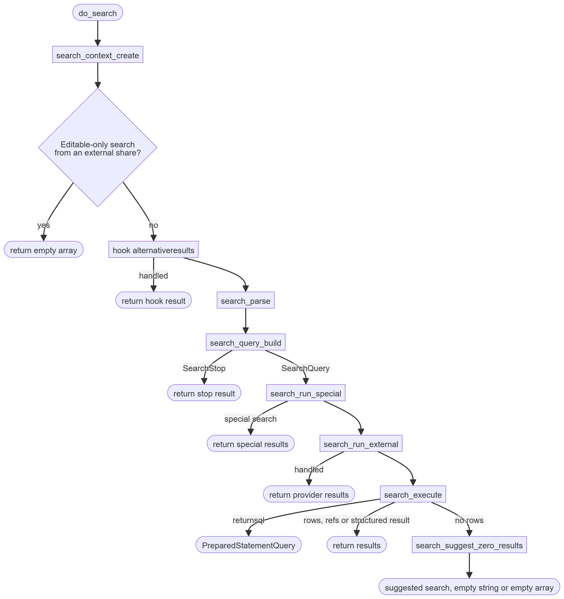
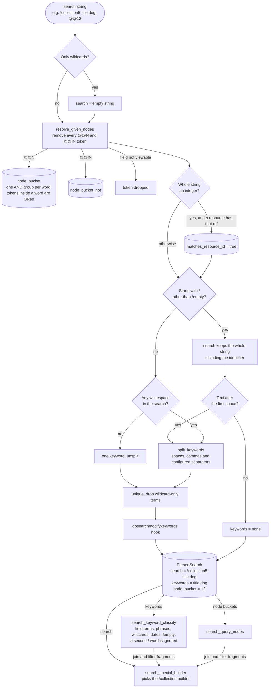
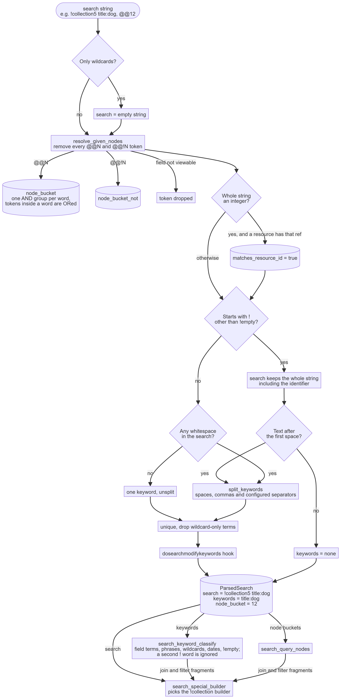
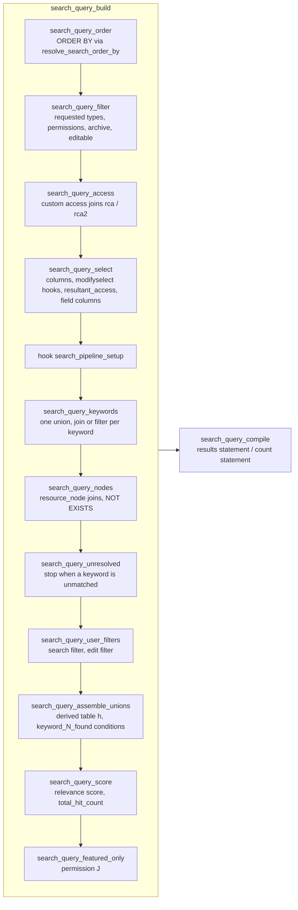
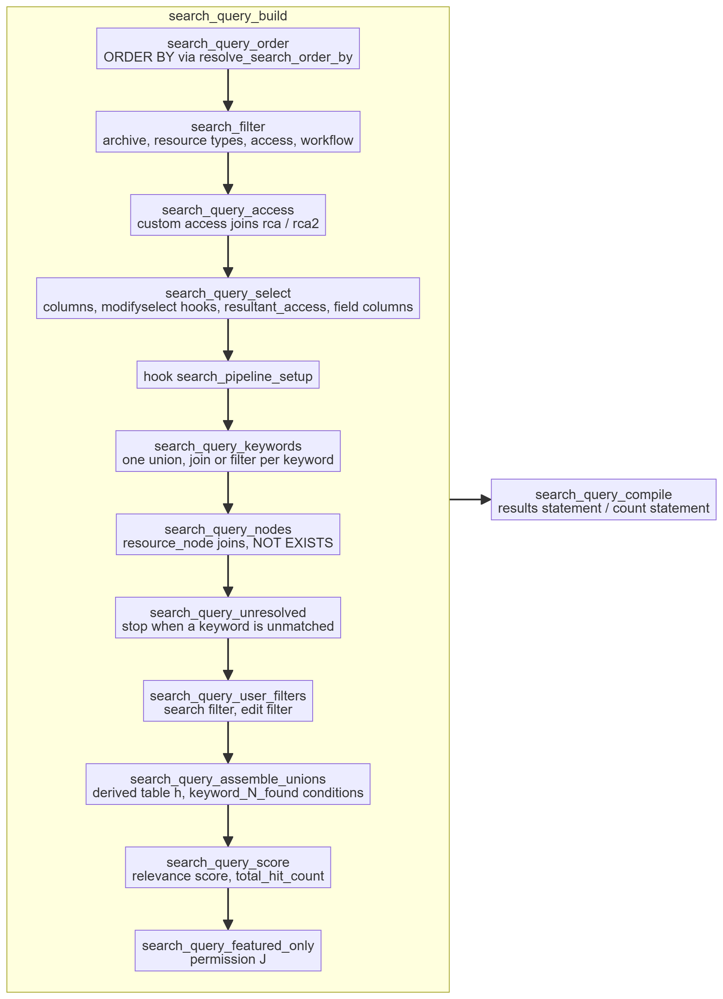
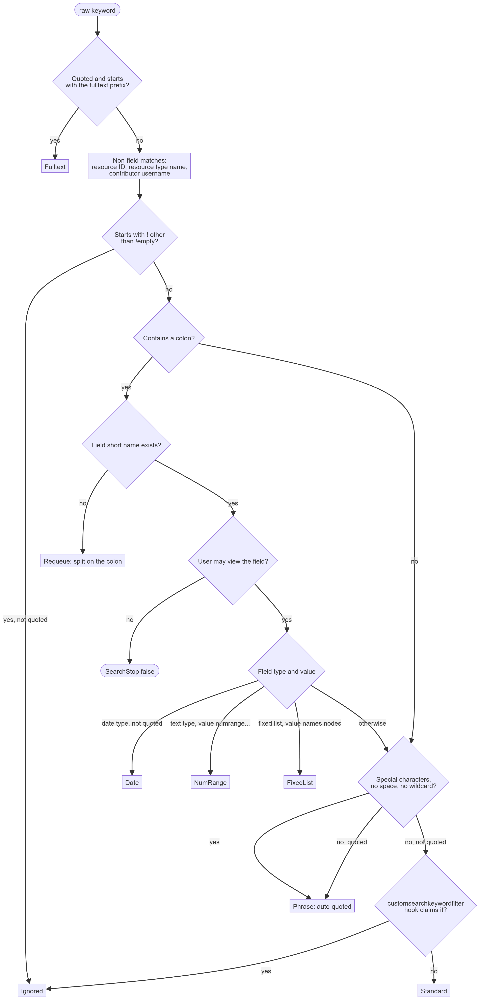
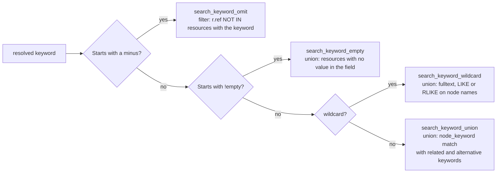
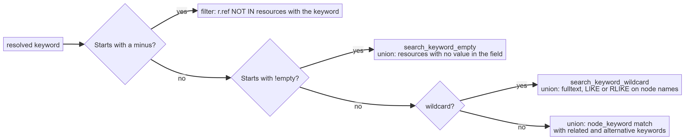
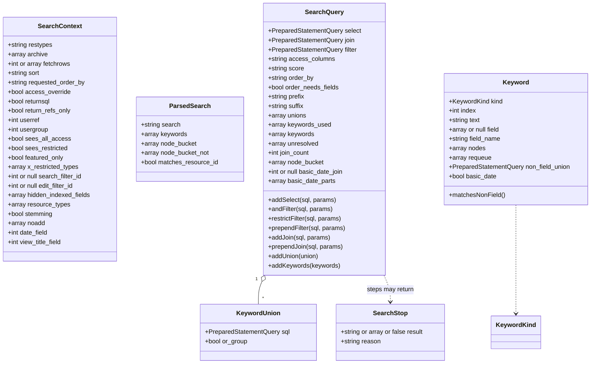
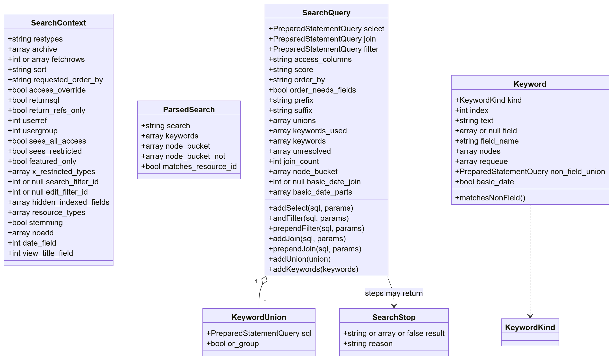

# The do_search() pipeline

`do_search()` turns a search string into a result set. It used to be one 500-line function plus five include
files that shared its local scope. It is now a short facade over a pipeline of plain functions with three value
objects passed between them:

| Object | Built by | Holds |
| --- | --- | --- |
| `SearchContext` | `search_context_create()` | Who is searching, with which options, under which permissions and configuration. Read-only. |
| `ParsedSearch` | `search_parse()` | The search string split into keywords and node restrictions; a special search keeps its identifier in the string. |
| `SearchQuery` | `search_query_build()` | The SELECT, JOIN and WHERE fragments, keyword unions and ORDER BY being assembled. |

A step that must end the search early (no access to a field, or a suggested search instead of results) returns a
`SearchStop` carrying the value `do_search()` gives back to its caller.

## Files

| File | Contents |
| --- | --- |
| `include/do_search.php` | `do_search()` facade, `search_run_special()`, `search_run_external()`, `search_execute()`, the result helpers shared with special searches (`search_fetch()`, `search_pad_rows()`), `search_suggest_zero_results()` |
| `include/search_context.php` | `SearchContext`, `search_context_create()`, legacy filter migration (`resolve_user_search_filter()`, `resolve_user_edit_filter()`) |
| `include/search_parse.php` | `ParsedSearch`, `search_parse()`, `resolve_given_nodes()` |
| `include/search_query.php` | `SearchQuery`, `KeywordUnion`, `SearchStop`, `search_query_build()` and the non-keyword pipeline steps, `search_query_compile()`, `search_query_compile_count()` |
| `include/search_order.php` | The ORDER BY step `search_query_order()`, `resolve_search_order_by()` with the named orderings, `search_order_by_field()` |
| `include/search_keywords.php` | `KeywordKind`, `Keyword`, `StandardKeyword`, `search_query_keywords()`, `search_keyword_classify()` and one function per keyword kind |
| `include/search_filter.php` | `search_query_filter()` and one `search_query_filter_<concern>()` step per clause of the base filter |
| `include/search_special.php` | `SpecialSearch`, `search_special_execute()`, `search_special_builder()`, `search_special_build()`, `search_special_finish()`, `search_special_compile()` and one builder function per special search |
| `include/search_functions.php` | Helpers kept from the previous implementation: `search_filter()` (which now wraps `search_query_filter()`), `search_special()` (which now wraps `search_special_execute()`), `resolve_keyword()`, `get_filter_sql()`, `setup_search_chunks()`, `log_keyword_usage()` |

`include/boot.php` loads them in that order.

Each diagram below is Mermaid source, rendered to a PNG in `documentation/images/` for viewers that do not
render Mermaid. Regenerate the images when the source changes.

## Call flow




`search_run_special()` wraps the query fragments and the context in a `SpecialSearch` and hands it to
`search_special_execute()`, described under [Special searches](#special-searches). `search_run_external()` unpacks
the `SearchQuery` and the context for the `external_search` hook, which keeps its original signature and is
handed the options as the caller passed them. Either way `do_search()` itself reads as the sequence above.

## Parsing the search string

`search_parse()` splits the string before any SQL is built. Node tokens come out first, from anywhere in the
string. A special search keeps the whole string, identifier included, so that `search_special_builder()` can
match it, and only the text after the first space becomes keywords. That is what makes a combination such as
`!collection5 title:dog, @@12` work: the collection builder gets the keyword and node restrictions as join and
filter fragments, built by the same steps a standard search uses. The four searches that match only the whole
string (`!images`, `!integrityfail`, `!locked`, `!noningested`) cannot be combined; `!images dog` becomes a
plain search for `dog`.





## Building the query

`search_query_build()` runs these steps in order. Each is a plain function taking the context, the query and,
where needed, the parsed search. The steps after the `search_pipeline_setup` hook depend on one another (keywords
add nodes, nodes and unions feed the score), and `search_query_build()` notes each dependency where it calls the step.





What each step touches on the `SearchQuery`:

| Step | select | join | filter | unions | score / order |
| --- | --- | --- | --- | --- | --- |
| `search_query_order` | | | | | order_by, order_needs_fields |
| `search_query_filter` | | | adds (the base filter) | | |
| `search_query_access` | | adds | adds | | |
| `search_query_select` | sets | | | | |
| `search_query_keywords` | | adds (dates, ranges) | adds (omit, dates, ranges) | adds | |
| `search_query_nodes` | | adds | prepends NOT EXISTS | | hitcount_select |
| `search_query_user_filters` | | | adds | | |
| `search_query_assemble_unions` | | adds derived table | adds union condition | consumes | |
| `search_query_score` | adds total_hit_count | | | | score |
| `search_query_featured_only` | | prepends | | | |

`search_query_filter()` in `search_filter.php` is itself a sequence, one function per clause in the order the
clauses appear in the SQL: `search_query_filter_requested()` (resource types and recent days),
`search_query_filter_contributors()` (`$resource_created_by_filter`), `search_query_filter_type_permissions()`
('T' permissions), `search_query_filter_confidential()` (no 'v' permission), `search_query_filter_archive()`
(archive states), `search_query_filter_pending()` (pending resources for a user without 'v'),
`search_query_filter_blocked_states()` ('z' permissions), `search_query_filter_media()` (`$heightmin`), the batch
upload template exclusion, `search_query_filter_access_level()` and `search_query_filter_editable()`.
Configuration comes from the context; permissions are read live because the `modifyuserpermissions` hook runs
first and may replace them.

The archive step does not know the special searches by name. `search_special_archive_states()`, which sits beside
the dispatch table in `search_special.php`, returns a `SearchArchiveStates` value for the search: `Any` for
collections, lists and the pending searches, `AllWorkflow` for related resources, `!hasdata` and integrity
failures, and `Requested` for everything else. The only special search the filter still names is `!collection`,
which has three rules of its own that configuration controls: resource types are ignored, archived members can be
omitted, and a collection shared with a key issued for it can show pending resources.

The editable-only clause is built from parts, one function each, joined with AND in this order and left out when
they do not apply: `search_editable_restricted()`, `search_editable_pending()`, `search_editable_states()`,
`search_editable_allowed_types()`, `search_editable_blocked_types()` and `search_editable_own_contributions()`.
`search_filter_ert_types()` lists the
resource types the user's 'ert' permissions name, which are exceptions in both pending rules and in the state rule.

`search_query_compile()` produces:

```sql
{prefix} SELECT DISTINCT {score} score, {select} FROM resource r {join}
WHERE {filter} GROUP BY r.ref, user_access, group_access ORDER BY {order_by} {suffix}
```

`search_query_compile_count()` gives the count statement used for paging: the same FROM, WHERE and GROUP BY with only `r.ref` and the two access
columns selected, which measured 1.1x to 4.0x faster than counting the full row. Disk-usage searches (which wrap
the statement in `{prefix}` and `{suffix}`) keep the full form because the wrapper reads the columns.

## Keywords

`search_query_keywords()` walks `SearchQuery::$keywords` by index. A handler may append tokens to that list (a
term containing a colon that is not a field name, or a term containing configured separators), so the loop
re-reads the count each time. The index identifies a keyword in `SearchQuery::$unresolved` and in SQL aliases.

`search_keyword_classify()` does all the string inspection once and returns a `Keyword` with a kind. It settles
the fulltext prefix, quoted phrases and `!` prefixed terms itself and hands a term containing a colon to
`search_keyword_classify_field()`, which resolves the field and picks the date, numeric range, fixed list, phrase
or standard form. `search_keyword_needs_quoting()` holds the rule that turns an unquoted term with special
characters into a phrase.




Each kind has one handler:

| Kind | Handler | Adds |
| --- | --- | --- |
| Fulltext | `search_keyword_fulltext()` | union: `MATCH(name) AGAINST` over node names |
| Date | `search_keyword_date()` | joins and filters on the date field; basicyear/month/day share one join |
| NumRange | `search_keyword_numrange()` | join and range filter on a text field |
| FixedList | (inline) | the resolved nodes go to `SearchQuery::$node_bucket` |
| Phrase | `search_keyword_phrase()` | union requiring adjacent keyword positions in one node, or a NOT IN filter for `-"..."` |
| Standard | `search_keyword_standard()` | see below |
| Requeue | (loop) | the split tokens are appended to the keyword list |
| Ignored | (none) | |

`search_keyword_standard()` first reads the form of the keyword with `search_keyword_standard_form()`: the `-`
prefix, alternatives, `!empty` and wildcards, returned as a `StandardKeyword`. It then resolves the keyword
(stemmed, then unstemmed, in `search_keyword_resolve()`), queues separator-split parts
(`search_keyword_separator_parts()`), records an unmatched plain keyword for the suggestion, then adds one of:





Three helpers are shared by the handlers: `search_keyword_restriction()` builds the clause excluding hidden
fields, fields excluded by the `excludefieldsfromkeywordsearch` hook and, for field-specific terms, every other
field (the phrase handler passes the alias of each word's `node_keyword` join); `search_keyword_alternatives()`
handles `red;blue`; `search_keyword_related()` adds related keywords, including stems when stemming is on.

`search_keyword_wildcard()` only chooses how to match and leaves the union to one of three functions:
`search_keyword_wildcard_fulltext()`, `search_keyword_wildcard_like()` and `search_keyword_wildcard_regex()`. The
last takes its full text prefilter from `search_keyword_wildcard_prefilter()`.

## Union assembly

Each keyword contributes a `KeywordUnion`: a SELECT returning `resource`, a `[bit_or_condition]` placeholder and
a score, plus a flag saying whether it is an alternative to its neighbours. `search_query_assemble_unions()`
numbers them, fills the placeholders, and joins one derived table:

```sql
JOIN (
    SELECT resource, sum(score) AS score,
           BIT_OR(keyword_1_found) AS keyword_1_found, BIT_OR(keyword_2_found) AS keyword_2_found
    FROM (
        SELECT resource, TRUE AS keyword_1_found, FALSE AS keyword_2_found, hit_count AS score FROM ... -- keyword 1
        UNION
        SELECT resource, FALSE AS keyword_1_found, TRUE AS keyword_2_found, hit_count AS score FROM ... -- keyword 2
    ) AS hits GROUP BY resource
) AS h ON h.resource = r.ref
```

and the WHERE condition `(h.keyword_1_found) AND (h.keyword_2_found)`. Consecutive unions flagged as
alternatives are OR'd within one bracket; the summed score becomes the relevance score.

## Objects





Only `SearchQuery` is mutable; the context, the parsed search and each `Keyword` are readonly. Keyword matching
copies the parsed keywords and node bucket onto the query and adds to them there. Steps change the query only
through its methods, so a reader can find every place a fragment is built by searching for the method name.

## Special searches

A special search answers instead of the standard query: the `!` searches, a resource ID when
`$config_search_for_number` is set, and anything a plugin claims through the `addspecialsearch` hook. They live in
`include/search_special.php` and run in three steps:

1. `search_special_builder()` names the builder for the search string. It is a single ordered `match`, so the
   precedence between identifiers that share a prefix (`!relatedpushed` before `!related`, `!colourkey` before
   `!colour`, `!listall` handled by the `!list` builder) is visible in one place. Searches that match only the
   whole string (`!images`, `!integrityfail`, `!locked`, `!noningested`) fall through to the standard query when
   keywords follow them.
2. `search_special_build()` runs the builder, then the `addspecialsearch` hook with whatever the builder produced,
   so a plugin can add a search or replace a core one. It returns the filled `SpecialSearch`, a `SearchStop` when
   the search is answered without a query (a collection the user may not see, an invalid `!duplicates` ID), or
   null when nothing recognised the search and the standard query should run.
3. `search_special_finish()` is the counterpart of `search_execute()`. It calls `search_special_compile()`, which
   fills the `[SELECT_SQL]`, `[GROUP_BY_SQL]` and `[ORDER_BY_SQL]` placeholders twice, for the full query and for
   the reduced query that counts rows or lists references. It then runs them through `search_fetch()`, fires
   `beforereturnresults` and pads a row limited result with `search_pad_rows()`.

The `!collection` builder is the only one with rules of its own before the query, so it is in four parts:

- `search_special_collection()` reads the collection number with `search_special_collection_ref()`, asks the two
  functions below and writes the query.
- `search_special_collection_denied()` returns the reason a user may not search the collection, or null. A user
  with the 'a' permission always may. Anyone else needs the collection to be on their list and readable, or to
  hold an external share key issued for it.
- `search_special_collection_listed()` answers whether the collection is on that list. It does not build the
  list: it reads the collection once with `search_special_collection_details()` and tests it against each rule
  with `search_special_collection_in_user_collections()`, `search_special_collection_public()`,
  `search_special_collection_requested()` and `search_special_collection_researched()`. The rules are those of
  `get_user_collections()`, `search_public_collections()`, `get_requests()` and `get_research_requests()`, so a
  change to one of those functions needs the same change here, and test 718 fails when they disagree. The
  group list of `$public_collections_confine_group` is shared: both read `public_collections_confined_groups()`.
  Building the list loaded every public collection for each collection search. With 3,000 public collections
  the single test took the database time of a collection search from 16 ms to 1 ms.
- `refresh_smart_collection()` in `include/collections_functions.php` brings a smart collection up to date with
  its saved search, in the background when `$smart_collections_async` is on. It is skipped when only the disk
  usage is asked for.

### The shared result tail

The standard query and a special search end the same way, through two functions in `do_search.php`:

- `search_fetch()` resolves `$fetchrows` into an offset and a row count (`setup_search_chunks()`) and runs the
  statement with a total (`sql_limit_with_total_count()`). The `!rgb` search, which is limited to 500 rows, passes
  that limit so a chunk cannot start past it.
- `search_pad_rows()` turns that into the list returned for an integer `$fetchrows`: the rows, followed by `0`
  entries up to the total when a row limit applies, or `[]` when nothing matched. Nothing is padded when every
  row was requested.

An array `$fetchrows` returns the total/data structure from `search_fetch()` as it is, on both paths. Three
differences between the paths are part of what callers and plugins see, so each path keeps them in its own
function, where they are a few lines side by side rather than two copies of the whole tail:

| | `search_execute()` | `search_special_finish()` |
| --- | --- | --- |
| Refs only | A list of `['ref' => N]`, never padded | The rows of the reduced query, padded like any other result |
| `beforereturnresults` | Given the padded rows; not called for refs only or when nothing matched | Given the total/data structure; always called for an integer `$fetchrows` |
| Keyword usage | Logged here; not logged when nothing matched | Logged by `search_run_special()` for every answered search |

A builder is a function `search_special_<name>(SpecialSearch $s): SpecialSearch` that fills `$s->sql` with the SQL
template and may rewrite `$s->select`, `$s->order_by`, `$s->join` and `$s->filter`. The template includes the
prefix and suffix itself, because some searches wrap the query differently. Four output properties carry what the
finish step needs beyond the template: `order_by_params` and `hard_limit` for `!rgb`, and `cache_count` for
`!hasdata`. The four searches that only add a condition on the resource row (`!archivepending`, `!images`,
`!integrityfail`, `!locked`) share `search_special_where()`.

The `!properties` builder reads the `name:value` parts and asks `search_special_property_condition()` for the
condition of each one. That function holds the table of plain comparisons (`hmin`, `hmax`, `wmin`, `wmax`, `pi`,
`cu`), converts megabytes for `fmin` and `fmax`, and hands `fext` and `orientation` to
`search_special_property_extension()` and `search_special_property_orientation()`. It returns null for a part
that is not a known property, and the builder skips it. A new property is one more entry in the table or one more
case.

`search_special()` in `search_functions.php` keeps its thirteen-argument signature for plugins and for test 1210;
it builds the `SpecialSearch` and calls `search_special_execute()`, the same entry `search_run_special()` uses.

The SQL each builder produces is unchanged from the previous implementation, including its whitespace, which the
snapshot test checks.

### Ordering

`search_query_order()` in `search_order.php` resolves the ORDER BY once, early in `search_query_build()`, because
the select step needs to know whether the ordering reads metadata field columns. `resolve_search_order_by()` holds
the table of named orderings; `search_order_by_field()` builds the clause for a `fieldN` ordering from the field's
sort method and constraint. The step cannot move into `search_context_create()`: the collection ordering depends
on the parsed search string, and the `modifyorderarray` hook would then run before `alternativeresults`.

A special search that needs something else rewrites `$s->order_by` in its builder: `!last` and the related
searches drop the table alias, `!rgb` orders by colour distance with its own parameters, and `!relatedpushed`
calls `resolve_search_order_by()` for its configured ordering. `set_search_order_by()`, the previous entry point,
had no callers left and has been removed along with the `$include_fieldx` global it wrote.

## Hooks

| Hook | Fired from | Arguments |
| --- | --- | --- |
| `modifyfetchrows` | `search_context_create()` | fetchrows |
| `modifyuserpermissions` | `search_query_filter()` | none; the return value replaces `$userpermissions` |
| `search_all_workflow_states_filter` | `search_query_filter_archive()` | filter (object, so plugins can append) |
| `modifysearcheditable` | `search_query_filter_editable()` | editable filter, userref; the return value replaces the clause |
| `alternativeresults` | `do_search()` | go |
| `dosearchmodifykeywords` | `search_parse()` | keywords, search |
| `modifyselect`, `modifyselect2` | `search_query_select()` | none; the return value is appended to the select |
| `search_pipeline_setup` | `search_query_build()` | search, select, join, filter, "" (objects, so plugins can append). May set the global `$keysearch` to false to skip keyword matching |
| `customsearchkeywordfilter` | `search_keyword_classify_field()` | [field name, value] |
| `excludefieldsfromkeywordsearch` | `search_keyword_standard()`, `search_keyword_phrase()` | none; returns field refs to exclude |
| `external_search` | `search_run_external()` | the call arguments plus filter, join, select |
| `addspecialsearch` | `search_special_build()` | search, select, join, filter, sql (objects; a returned `PreparedStatementQuery` replaces the query) |
| `modifycollectionsearchsql` | `search_special_collection()` | sql; a returned query replaces it |
| `beforereturnresults` | `search_execute()`, `search_special_finish()` | result, archive (rows from the standard query; the total/data structure from a special search) |
| `zero_search_results` | `search_suggest_zero_results()` | none |

Two ordering differences from the previous implementation: `modifyfetchrows` now fires while the context is
built, before `alternativeresults`; and the legacy text-filter migration runs at context creation even for
searches that return early.

## Extending

To add a keyword form: add a case to `KeywordKind`, detect it in `search_keyword_classify()`, write a
`search_keyword_<kind>()` function that adds to the `SearchQuery`, and dispatch it in `search_query_keywords()`.
To add a pipeline step: write `search_query_<step>(SearchContext $ctx, SearchQuery $query)` and call it from
`search_query_build()` at the right point. To add a core special search: write
`search_special_<name>(SpecialSearch $s): SpecialSearch` in `search_special.php` and add its match to
`search_special_builder()` at the right point in the order, and to `search_special_archive_states()` below it
when the search should not be limited to the requested archive states; a plugin uses the `addspecialsearch` hook instead.
Steps take what they need from the context; a step that keeps to that can be exercised with a hand-built
`SearchContext`. Globals remain in three places: `$keysearch` in `search_query_build()`, the helpers kept from the
previous implementation (`get_filter_sql()`), `resolve_search_order_by()`, which reads `$date_field` and
`$view_title_field` because the `!relatedpushed` builder calls it without a context, the filter steps, which read
`$userpermissions` live because the `modifyuserpermissions` hook may replace it, and the special
search builders, each of which declares the configuration globals it reads.

## Tests and tools

| Check | What it does |
| --- | --- |
| `tests/test_list/000705_do_search_sql_snapshot.php` | Runs 210 searches, including every special search branch, every base filter clause and every branch of the keyword classifier and the standard keyword path, with `$returnsql` for three permission profiles and compares the normalised SQL and parameters with the generated `test_000705_expected()` block at the end of the same file. Any change to the generated SQL fails it. Regenerate only on code known to be correct: `RS_TEST_UPDATE_SNAPSHOTS=1 php tests/test.php 705` rewrites the block in place. |
| `tests/test_list/000706_do_search_keyword_restrictions.php` | Excluded and hidden fields are both bound in every keyword union, with matching placeholders. |
| `tests/test_list/000707_do_search_zero_result_suggestion.php` | A search whose keywords never occur together suggests dropping the least used one. |
| `tests/test_list/000708_do_search_editable_states.php` | Editable-only searches exclude each configured additional archive state the user cannot edit. |
| `tests/test_list/000701_do_search_special_states.php` | `!archivepending`, `!userpending`, `!resource` and `!listall` against resources in each workflow state. |
| `tests/test_list/000702_do_search_special_images.php` | `!images`, `!colourkey`, `!colour`, `!rgb` and `!geo` against preview columns written directly, and the base filter on both `!colour` patterns for an administrator and for a user without the 'v' permission. |
| `tests/test_list/000703_do_search_order_by.php` | Every named ordering in `resolve_search_order_by()`, plus the fallbacks for an unknown value and for a field outside the table joins. |
| `tests/test_list/000704_do_search_result_options.php` | Row limit padding, chunked fetchrows, refs only with and without a row limit, a search matching nothing, disk usage totals, the recent days limit and the archive list. |
| `tests/test_list/000709_do_search_hooks.php` | The keyword, select, special search, editable filter, fetchrows, alternative results, before-return and zero-results hooks through a test plugin. |
| `tests/test_list/000711_do_search_special_properties.php` | Every `!properties` option, their combination, ignored values and a node restriction. |
| `tests/test_list/000712_do_search_special_flags.php` | `!integrityfail`, `!locked`, `!nopreview`, `!hasdata`, `!contributions` and `!last` against resource columns written directly. |
| `tests/test_list/000713_do_search_special_collection.php` | `!collection` members in every archive state, collection columns and ordering, `$collections_omit_archived`, a node restriction and access for a non-administrator. |
| `tests/test_list/000714_do_search_special_results.php` | Row limit padding, no padding when every row is requested, chunked fetchrows, a search matching nothing, the reduced refs-only query with and without a row limit, disk usage and returned SQL for a special search. |
| `tests/test_list/000715_do_search_collection_access.php` | Who may search a collection: an administrator, the owner, a user or group it is shared with, public and featured collections with each 'j' permission, requested and research collections, `$ignore_collection_access`, share keys (issued for the collection, made up, issued for another collection, expired, password protected, an upload link), an upload share and the upload review collection. Also the smart collection refresh. |
| `tests/test_list/000716_do_search_date_range_field.php` | A date range field searched with a single date: inside, on the first and last day of, and outside two ranges, written with vertical bars and with hyphens. Also a month or a year, which finds every range overlapping it, and a range whose start is a year only. |
| `tests/test_list/000717_do_search_editable_edit_access.php` | Editable-only searches of an archive state the user cannot edit, with the contributor option and 'ert' permissions in each combination, compared with `get_edit_access()` for every fixture. Also `$edit_only_own_contributions` with and without those exceptions. |
| `tests/test_list/000718_do_search_collection_listed.php` | The list of collections a user may search without a share key, for 35 collections and 17 kinds of user: the 'R', 'Ra', 'Rb', 'r' and 'j' permissions, `$themes_in_my_collections`, `$public_collections_confine_group`, the anonymous user with session collections and an upload share. Each answer is compared with the expected one and with the list built from the list functions. |
| `tests/test_list/000460` to `000700` | The pre-existing behaviour tests. |

The snapshot does not cover the count statement or execution. Those are covered by the behaviour tests, which
page through real results.

## Upstream changes carried into this structure

The branch was rebased onto trunk as of 2026-11-13. Trunk had changed code that this structure moved, so those
changes were applied by hand in their new places. Running the snapshot cases against trunk's own code gives the
same SQL as this structure, apart from the behaviour changes listed in the next section.

| Trunk change | Where it lives here |
| --- | --- |
| `do_search()` parameter `$resource_collection`, limiting results to one collection | `SearchContext::$resource_collection`, applied in `search_query_build()` straight after the base filter, so special searches get it too |
| `r.blurhash` in the result columns | `search_query_select()` and the column list in `search_special_compile()` |
| A reduced count statement for paging | Already present as `search_query_compile_count()`, which selects the same columns; trunk's version was not copied |
| Dimensions join limited to the original file (`rdim.preview_size IS NULL`) | `search_special_properties()` |
| A quoted field search containing `;` is a set of alternatives, not a phrase | `search_keyword_classify_field()` |
| Alternatives are filtered once, an empty group matches nothing, and a group never produces a suggestion | `search_keyword_standard_form()` and `search_keyword_standard()` |
| Alternatives containing punctuation are matched literally in node names, together with any that are indexed | `search_keyword_standard()` passes them to `search_keyword_wildcard()`, where `search_keyword_wildcard_regex()` handles them; `search_keyword_alternative_refs()` supplies the indexed ones |
| `!empty`: `Global` in the requested types, candidates limited in the outer query, no candidates means no results | `search_keyword_empty()` |

Trunk's changes to `split_keywords()`, `prepare_regex_search_string()` and `refine_searchstring()` merged without
conflict, as those functions were not moved.

## Behaviour changes made during the restructuring

Each of these was a defect in the previous code, confirmed by a failing test or by reading:

- A wildcard union overwrote its field restriction clause instead of appending to it, while merging both
  parameter sets.
- The `!empty` visibility check called `explode()` on the hook's array, which throws on PHP 8.
- `!emptyFIELDNAME` bound the field name as an integer, so MySQL matched the first field with a non-numeric name.
- Quoted phrases applied the `excludefieldsfromkeywordsearch` hook only if an earlier keyword had already called it.
- A date range term reused a start or end bound left over from an earlier keyword in the same search.
- The zero-result suggestion bound keyword text as an integer and so picked the least used keyword of the whole
  table.
- An edit filter with no rules produced a dangling `AND`.
- A keyword that is a wildcard too short for the stop word pattern built an empty statement.
- An `!empty` search naming no field, or a field that does not exist, returns `false` (no results, as for a field
  the user may not see) instead of ending the page with `exit()`. An unloadable user search filter still exits,
  because that is a configuration fault administrators must notice.
- An `!empty` search on a non-global field whose resource types are not among the searched types built `IN ()`,
  a syntax error. It now matches no resource, since no searched resource can hold the field. Upstream made the
  same fix and also moved the resource type condition out of the subquery, where it let through every resource
  of another type.
- A wildcard keyword that takes the LIKE path and also matches a resource type or contributor name merged the
  parameters of that match without its SQL. The match is now appended to the union, as on the other wildcard paths.
- `!emptyFIELDNAME` with a special character in the short name (`!emptysnap_under`) was quoted into a phrase
  search or split at the configured separator, and returned `false`. It is now handled as an `!empty` search.
- `!unused` with `$return_disk_usage` appended the closing `) resourcelist` of the disk usage wrapper twice, and
  `!duplicatesN` left the wrapper out, so both failed or returned rows instead of a total.
- A special search asked for every row (`$fetchrows` of -1) padded its result up to the total, which for
  `!hasdata` can be a cached count that is out of date. Like the standard query, it now pads only when a row
  limit applies.
- `!relatedpushed` with `$return_disk_usage` opened the disk usage wrapper in both halves of its UNION and closed
  it once, which is a syntax error. The wrapper now opens once.
- Ordering by a field that is not among the resource table joins raised an error, because the fallback name
  `resourceid` was then treated as a field column. It now orders by resource ID, as
  `check_order_by_in_table_joins()` intends.
- `!geo` followed by keywords or nodes ran the last join condition into `WHERE` without a space.
- An editable-only search accepted any numeric suffix on an 'ert' permission where the pending filter accepted
  only an integer. Both now read the permissions through `search_filter_ert_types()` and require an integer.
- `!colour` wrote its two patterns as `a OR b AND filter`, so the base filter applied to the second pattern only
  and a resource matching the first was returned whatever its archive state, access or type permissions. The
  patterns are now bracketed.
- `!collectionN` accepted any non-empty external share key from a user without the 'a' permission, so a signed in
  user could list another user's private collection by adding a made up key to the URL. The search page checks
  the key only to decide whether to ask for a login, and leaves a failed key in place. The builder now asks
  `collection_access_key_valid()`, which accepts a key that was issued for that collection, has not expired, is
  not an upload link, belongs to an approved user and, for a share with a password, comes with the share access
  cookie. It only reads the key: `check_access_key_collection()` also emulates the sharing user and redirects,
  and without its resource check accepts a key issued for any collection. `collection_readable()` made that
  call without the resource check, so a key from sharing any collection made every collection readable. It now
  uses the same function; `tests/test_list/000885_collection_readable_access_key.php` covers it.
- With `$collection_allow_not_approved_share` on, a collection search with any non-empty key dropped the filter
  that hides other users' pending resources. A signed in user could add a made up key to the search of a
  collection they may see, such as a public one, and be shown them. `search_query_filter_pending()` now drops
  the filter only for a key that `collection_access_key_valid()` accepts for that collection. The key is held in
  `SearchContext::$share_key`.
- An editable-only search hid resources that `get_edit_access()` lets the user edit. In an archive state the user
  has no 'e' permission for, a resource is editable by its contributor when `$edit_access_for_contributor` is on
  and by anyone holding an 'ert' permission for its type. When both could apply, the search required both. It now
  accepts either, as `get_edit_access()` does.
- An editable-only search ignored `$edit_only_own_contributions`, which `get_edit_access()` applies before any
  permission. With the option on it returned other users' resources, so a batch edit of the results was refused
  as a whole and a collection looked fully editable when it was not. `search_editable_own_contributions()` now
  adds the rule.
- A date range field searched with a single date (`field:2024-05-17`) bound its four parameters as field, field,
  date, date against placeholders that read field, date, field, date. The second join then looked for a field
  numbered after the year, so the search never found anything. The parameters are now in placeholder order and
  the search finds every resource whose range contains the date.
- The same search with a month or a year alone (`field:2024-05`, which the search form can send) found nothing,
  because the join compared `DATE()` of a node with text that is not a date. Range nodes are named `YYYY-MM-DD`,
  so the join now compares them as text: a node on or after the value, and a node on or before the value padded
  to ten characters with `-99`. A month or year finds every range that overlaps it.

One function was removed: `set_search_order_by()` had no callers in core or the bundled plugins. A site plugin
that calls it should call `resolve_search_order_by()` and read `order_by` from the result.

Known and left alone: two consecutive alternative keywords (`a;b c;d`) are OR'd together rather than both
required.
